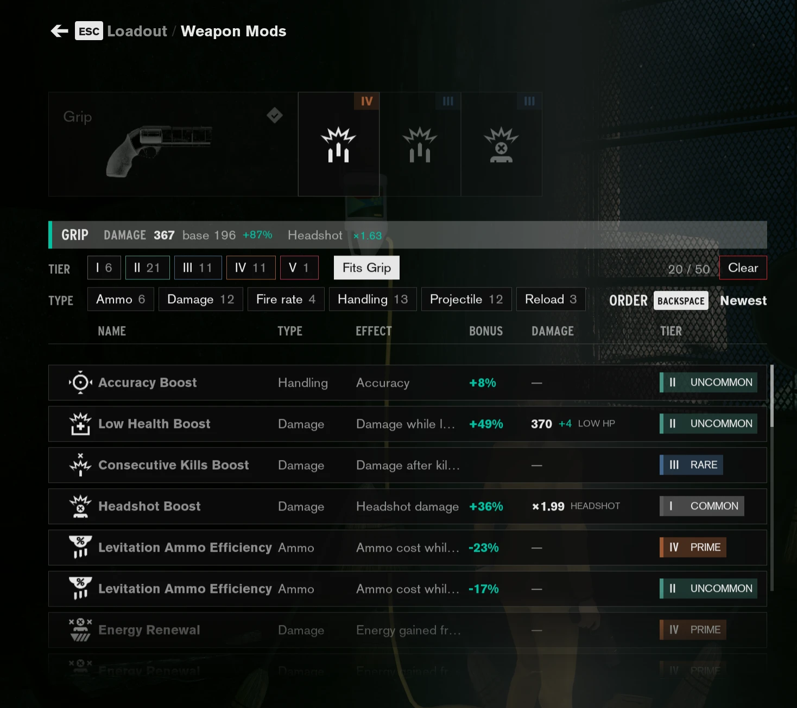
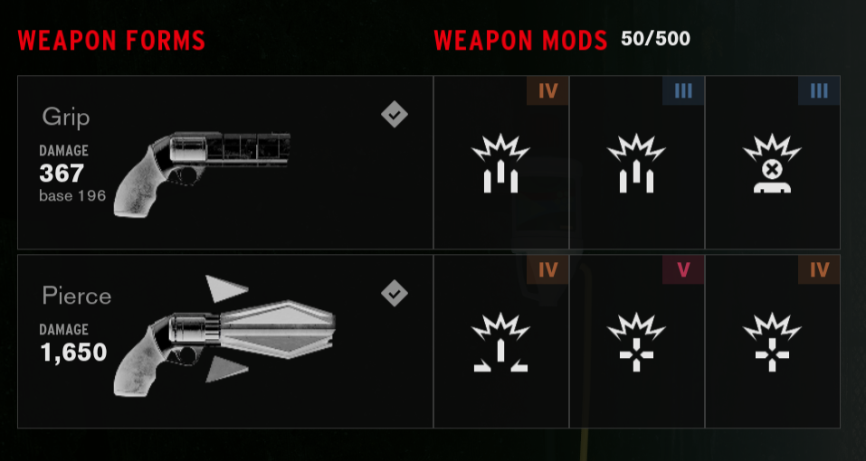

# Control mods

A sortable, filterable table (type, effect, tier, damage) replaces the tile grids for Weapon Mods and Personal Mods in Control's Loadout, weapon tiles show their real damage, and an optional plugin raises the mod inventory limit to 500.

Install, controls, how it works and troubleshooting: [docs/GUIDE.md](docs/GUIDE.md).
